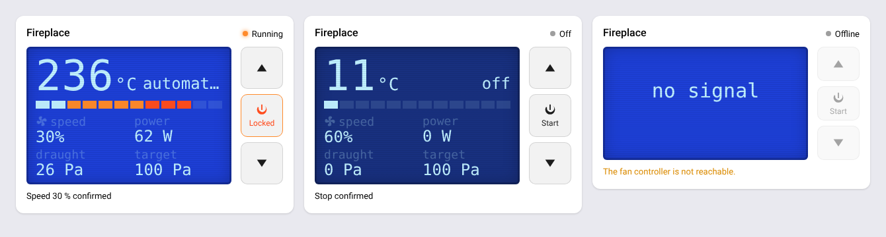
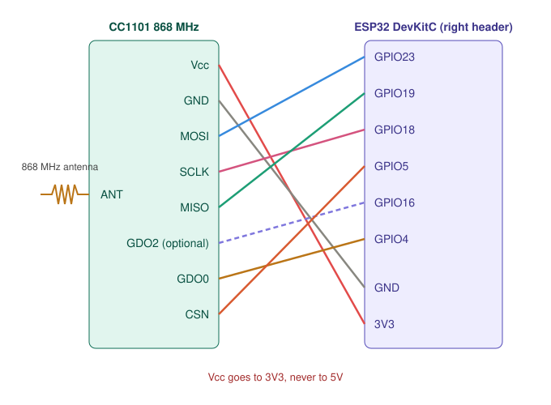

# exodraft EW41 for Home Assistant

Read and control an **exodraft EW41 wireless flue gas fan** from Home Assistant, using an ESP32 and a CC1101 868 MHz radio module that speaks the fan's own Z-Wave based protocol. No changes to the fan, the panel or the wiring at the chimney.



What you get in Home Assistant:

- Flue temperature, draught (Pa), pressure setpoint, fan power (W) and fan speed (%)
- Operating mode (Off, Start, Automatic, Boost, Manual)
- Start and stop the fan, and set its speed from 20 to 100 %
- A safety lock that refuses to stop the fan while the flue is hot
- Commands that are confirmed by the power unit and resent automatically if they get lost
- A Lovelace card styled as a backlit LCD control panel, installable through HACS

The panel keeps working exactly as before. The ESP32 joins the conversation as a second voice, it does not replace anything.

> **Not affiliated with exodraft a/s.** This is an independent, reverse engineered integration. A flue gas fan is part of a fireplace's safety system: the fan's own controller stays in charge of start-up, run-on and temperature alarms, and this project never bypasses it. Use at your own risk, and read the [safety notes](#safety).

## Compatibility

This project was built and tested with an **EW41** set: power unit at the chimney, battery panel with a blue LCD (part 0502301), firmware *display 88, power unit 44, Z-Wave 2.97*. Your set is very likely compatible if the panel's software screen shows a **Z-WAVE version and a HOME ID**.

The current exodraft Xzense does **not** need this project: its power unit has wired building-automation terminals (start/stop and 0–10 V in and out) that you can connect directly.

## Components

| Part | Notes | Approx. cost |
|---|---|---|
| ESP32 DevKitC (ESP32-WROOM-32 or -32U) | Any classic ESP32 dev board works. The -32U variant needs its external Wi-Fi antenna attached. | 80–120 SEK |
| CC1101 module, **868 MHz version** | Must be the 868 MHz variant, the common 433 MHz modules perform poorly here. Usually supplied with a spring antenna. | 50–100 SEK |
| Jumper wires, female Dupont ends | 7 wires, 8 if you also connect GDO2 | – |
| USB power supply and enclosure | Place the device between the panel and the chimney | – |
| Soldering iron | The CC1101 module comes without headers | – |

Optional, for exploring the protocol yourself: an RTL-SDR dongle. It is not needed to build this project.

## Build steps

### 1. Solder and wire



| CC1101 | ESP32 |
|---|---|
| Vcc | 3V3 (never 5V) |
| GND | GND |
| MOSI | GPIO23 |
| SCLK | GPIO18 |
| MISO | GPIO19 |
| CSN | GPIO5 |
| GDO0 | GPIO4 |
| GDO2 | GPIO16 (optional, not used by the firmware) |
| ANT | Spring antenna |

All ESP32 connections are on the same header. Solder short wires (under 10 cm) directly to the CC1101 and finish them with female Dupont connectors. More detail in [docs/hardware.md](docs/hardware.md).

### 2. Read your Home ID

On the EW41 panel, open the software information screen. Note the **HOME ID**, for example `D4E36193`. It becomes four bytes: `0xD4 0xE3 0x61 0x93`.

### 3. Flash the discovery firmware

Flash [`esphome/exodraft-discovery.yaml`](esphome/exodraft-discovery.yaml) and open the log. Wake the panel a few times. From the logged frames you get:

- the **power unit's node ID** (the `dst` of frames sent by `src=1`)
- your module's **frequency offset** (`foff`)

Step-by-step instructions are in [docs/discovery.md](docs/discovery.md).

### 4. Flash the real firmware

Copy [`esphome/example-device.yaml`](esphome/example-device.yaml) to your ESPHome directory, fill in the substitutions from steps 2 and 3, and flash it. The device pulls the integration in as a remote package from this repository, so updates arrive the next time you build.

```yaml
substitutions:
  home_id_0: "0xD4"
  home_id_1: "0xE3"
  home_id_2: "0x61"
  home_id_3: "0x93"
  power_unit_node: "0x09"
  power_unit_sync: "0xF6"   # 0xFF minus power_unit_node
  frequency: 868.469MHz     # 868.42 MHz + your foff
```

Within a few seconds of booting, the log should show `RX src=9 dst=1 ...` lines and the sensors in Home Assistant fill in.

### 5. Add the device to Home Assistant

Home Assistant discovers the device through the ESPHome integration. Accept it and enter the API key from your secrets.

### 6. Install the card

**Through HACS (custom repository, until the card is in the default HACS store):**

1. HACS, three-dot menu, *Custom repositories*
2. Add `https://github.com/greberg/exodraft-ew41` with type *Dashboard*
3. Find *Exodraft EW41 Card* in HACS and download it
4. Reload the browser

**Manually:** copy `dist/exodraft-card.js` to `config/www/` and add `/local/exodraft-card.js` as a JavaScript module resource.

Then add the card to a dashboard:

```yaml
type: custom:exodraft-card
name: Fireplace
```

## Card options

| Option | Default | Description |
|---|---|---|
| `name` | `Flue gas fan` | Card title |
| `prefix` | `exodraft` | ESPHome device name, used to build the default entity IDs |
| `lock_temperature` | `50` | Above this flue temperature the stop button is locked. Keep it equal to `shutdown_lock_temp` in the firmware |
| `max_temperature` | `300` | Top of the temperature bar |
| `min_speed` | `20` | Lowest speed the down button goes to |
| `speed_step` | `10` | Step size of the speed buttons |
| `show_status` | `true` | Show the command status line |
| `entities` | | Override individual entity IDs: `fan`, `speed_setting`, `temperature`, `power`, `draught`, `setpoint`, `speed`, `mode`, `status` |

Example with a different device name and one overridden entity:

```yaml
type: custom:exodraft-card
name: Living room stove
prefix: stove_fan
entities:
  temperature: sensor.chimney_temperature
```

The speed buttons are debounced: tap a few times and only the final value is sent. While the power unit has not confirmed a new value, it blinks on the display.

## Entities

| Entity | Type | Description |
|---|---|---|
| Fan | switch | Start and stop. Shows the requested state while waiting for confirmation |
| Fan speed setting | number | 20–100 % in steps of 10 |
| Flue temperature | sensor | °C, from the power unit's sensor |
| Draught | sensor | Pa, measured by the power unit |
| Pressure setpoint | sensor | Pa, the target pressure configured in the panel |
| Fan power | sensor | W |
| Fan speed | sensor | % reported by the power unit |
| Operating mode | text sensor | Off, Start, Automatic, Boost, Manual |
| Command status | text sensor | What the last command is doing (diagnostic) |
| Operating mode (raw) | sensor | The raw mode byte (diagnostic) |
| Radio signal | sensor | dBm of the last received report (diagnostic) |
| Refresh status | button | Ask the power unit for a report right now (diagnostic) |

## How it works

The EW41 panel and power unit talk classic Z-Wave on 868.42 MHz: the panel is the primary controller (node 1), the power unit a slave node. Fan speed uses the standard *Switch Multilevel* command class; status, start and stop use exodraft's *Manufacturer Proprietary* frames. Traffic is unencrypted, so the ESP32 can read the power unit's reports and send the same commands the panel sends.

The full protocol description, including frame layouts and how the CC1101 is configured to catch frames that follow each other within milliseconds, is in [docs/protocol.md](docs/protocol.md).

## Safety

- The power unit's own logic (start-up boost, run-on, temperature and draught alarms) is never bypassed.
- The firmware refuses to stop the fan if the flue temperature is unknown or at least `shutdown_lock_temp` (default 50 °C). The card shows the same lock.
- The lowest speed you can set is `min_speed` (default 20 %).
- Commands are sent once and repeated at most twice. There are no transmit loops.
- The 868.0–868.6 MHz band allows 1 % duty cycle. A status request takes about 7 ms on air; the default polling uses a tiny fraction of the budget.
- Keep the original panel in place and powered. It remains the primary controller and the authority on the fan's operation.

## Troubleshooting

| Symptom | Likely cause |
|---|---|
| Log shows `FF0F`, `0000` or `FFFF` during setup | SPI wiring. Check MISO, MOSI, SCLK and CSN |
| Wi-Fi `Auth Expired` | Weak signal or Wi-Fi settings. Check the -32U antenna, use WPA2/WPA3 mixed with PMF optional, disable 802.11r for the IoT network |
| No `RX` lines at all | Wrong frequency offset, wrong node ID or sync byte, or the device is too far from the chimney |
| `RX` lines but sensors stay empty | Frames from another device. Check the Home ID substitutions |
| Card shows *no signal* | The switch entity is unavailable. Check that the ESPHome device is online and the `prefix` matches |
| Commands time out (*No confirmation from the power unit*) | Weak link to the power unit. Move the device closer to the chimney, check `frequency` |

## Repository layout

```
esphome/exodraft-ew41.yaml       ESPHome package with the whole integration
esphome/example-device.yaml      Your device file, pulls in the package
esphome/exodraft-discovery.yaml  One-off firmware to find Home ID, node ID and frequency offset
dist/exodraft-card.js            Lovelace card (no build step)
docs/                            Hardware, discovery, protocol and publishing notes
hacs.json                        HACS metadata
```

## License

MIT, see [LICENSE](LICENSE). exodraft is a trademark of its owner and is used here only to describe compatibility.
