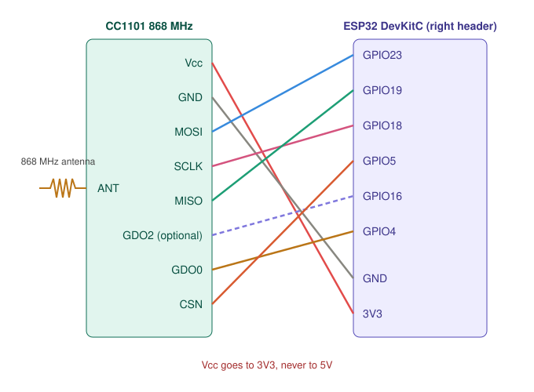

# Hardware

## CC1101 module

Buy a module that is explicitly the **868 MHz** version. The CC1101 chip covers 300–928 MHz, but the module's matching network and antenna are tuned for one band, and a 433 MHz module loses a lot of range at 868 MHz. The common green module marked *CC1101 868MHz Module* with a spring antenna works well.

The module this project was built with has a single row of 8 holes on one side and 3 antenna holes on the other:

```
Vcc  GND  MOSI  SCLK  MISO  GDO2  GDO0  CSN        GND  ANT  GND
```

Check the pin spacing before you buy headers. Some modules use 2.54 mm, others 2.0 mm. Soldering wires straight into the holes works for both.

## Which pins are needed

| Pin | Needed | Why |
|---|---|---|
| Vcc, GND | Yes | Power, 3.3 V only. The CC1101 is damaged by 5 V |
| MOSI, SCLK, MISO, CSN | Yes | SPI bus |
| GDO0 | Yes | Signals packet received and sent. ESPHome requires it in packet mode |
| ANT | Yes | Solder the spring antenna here |
| GDO2 | No | Spare status output, not used. Connect it to GPIO16 if you want it available later |
| The two GND next to ANT | No | Only for mounting an SMA connector |

## Wiring

| CC1101 | ESP32 | DevKitC header position |
|---|---|---|
| Vcc | 3V3 | Right side, bottom |
| GND | GND | Right side, second from bottom |
| MOSI | GPIO23 | Right side, top |
| MISO | GPIO19 | Right side |
| SCLK | GPIO18 | Right side |
| CSN | GPIO5 | Right side |
| GDO0 | GPIO4 | Right side |
| GDO2 | GPIO16 (optional) | Right side |

GPIO18, 19, 23 and 5 are the ESP32's hardware SPI (VSPI). GPIO2 is avoided for GDO2 because it is a boot strapping pin and drives the on-board LED. If you change pins, override `clk_pin`, `mosi_pin`, `miso_pin`, `cs_pin` and `gdo0_pin` in your device file.



## Assembly tips

- Keep wires short, ideally under 10 cm. Use different colours and label them.
- Cut female-female Dupont jumpers in half and solder the bare ends into the module. The Dupont ends plug onto the ESP32's headers, so you can disconnect and rewire without soldering again.
- Point the spring antenna upwards and keep it a few centimetres away from the ESP32's Wi-Fi antenna.
- On an ESP32-WROOM-32U, attach the external Wi-Fi antenna to the u.FL connector. Without it, Wi-Fi is weak and unstable.

## Placement

The panel is usually close, the power unit is outside on the chimney. The power unit's signal is the one that matters, so place the device between the two, ideally near a window facing the chimney. A received signal around -70 dBm, as shown by the *Radio signal* entity, gives a comfortable margin. Below roughly -90 dBm, frames are discarded as noise.

## First power-up checks

In the ESPHome log right after boot:

- `Chip ID: 0x0004` means SPI works. Some clone chips report a different version number, which is fine as long as it is not one of the values below.
- `FF0F`, `0000` or `FFFF` means an SPI wiring fault.
- `Frequency` and `Symbol Rate` should be close to your configured values (the chip rounds them slightly).
